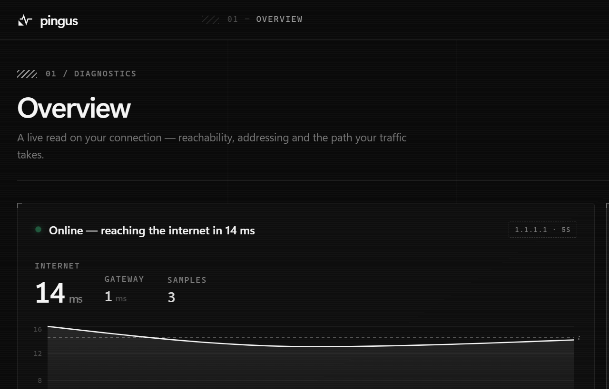

<p align="center">
  
</p>

<h1 align="center">PingUs</h1>

<p align="center">
  <b>Premium all-in-one network diagnostics & monitoring for Windows.</b><br/>
  Latency, routes, DNS, devices, Wi-Fi and packets, in one calm, monochrome desktop app.
</p>

<p align="center">
  <a href="https://github.com/magnuskss/PingUs/releases/latest"></a>
  <a href="LICENSE"></a>
  
  
</p>

<p align="center">
  
</p>

---

## Features

- **Live status** — public/local IP, gateway, DNS, interfaces and an overall health score at a glance.
- **Live latency** — continuous ping with jitter, packet loss and a live chart.
- **Traceroute** — per-hop route and latency, animated on a map.
- **DNS analyzer** — A, AAAA, MX, TXT, NS, CNAME, SOA and PTR (including reverse lookups).
- **Speed test** — download, upload, ping and jitter.
- **Device discovery** — sweep your local network for devices (IP, MAC, hostname).
- **Port scanner** — TCP connect scan, with optional Nmap service detection.
- **Wi-Fi analyzer** — signal strength, channel usage and nearby networks.
- **Packet analyzer** — live capture and inspection via TShark (Wireshark).
- **Device monitor** — watch hosts, track uptime and get notified when they go offline.
- **OSINT search** — passive lookups on a domain or IP: public registries, DNS, certificate transparency and IP intelligence. It never probes the target.
- **History** — saved scans with a detail view and JSON/CSV export.

## Download

Grab the latest `PingUs-x.y.z-Setup.exe` from the [**Releases**](https://github.com/magnuskss/PingUs/releases/latest) page and run it. The installer lets you choose the install folder and creates Start menu and desktop shortcuts.

> PingUs currently targets **Windows 10/11 (x64)**.

## Build from source

Requirements: Node.js 20+ and npm.

```bash
npm install
npm run dev        # run in development mode
```

To produce the Windows installer:

```bash
npm run build
npm run dist       # output is written to release/
```

## Optional integrations

- **Nmap** enables service and version detection in the Port Scanner. Install it, then set its path in **Settings**.
- **Wireshark / TShark** is required for the Packet Analyzer. It needs Npcap, and capturing may require running as administrator. Set the `tshark` path in **Settings**.

## Architecture & security

- **Secure Electron setup:** `contextIsolation: true`, `nodeIntegration: false`, a typed `contextBridge` preload, external links opened in the OS browser, locked-down navigation and a strict CSP in packaged builds.
- All network operations run in the **main process**. The renderer never touches the network directly.
- User-supplied hosts are validated before use, and commands are spawned with explicit argument lists (no shell).
- **History** uses SQLite (`better-sqlite3`) when the native module is available and falls back to a JSON store otherwise, so the app always runs.

## Responsible use

PingUs is for diagnosing and monitoring networks and systems **you own or are explicitly authorized to test**. Scanning or capturing traffic on networks without permission may be illegal.

## Contributing

Issues and pull requests are welcome. Please keep changes focused, and run `npm run typecheck` before opening a PR.

## Changelog

See [CHANGELOG.md](CHANGELOG.md) for release notes.

## License

[MIT](LICENSE)
